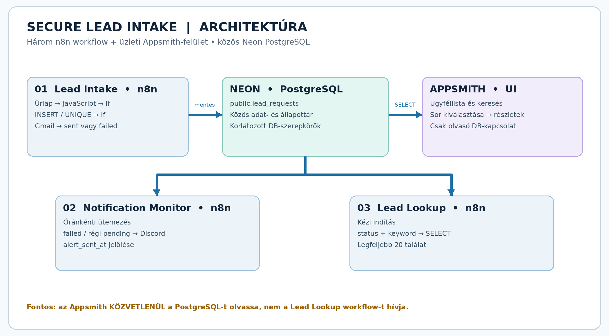

# Secure Lead Intake

**Rule-based quote-request processing with n8n, PostgreSQL and Appsmith**

> 🇭🇺 [Magyar összefoglaló lent](#magyar-összefoglaló)

> **Status:** Tested portfolio demo, **not a production system**. Built and tested in November 2026 on n8n Cloud. The n8n Cloud subscription has since ended, so **the workflows are no longer running**. This repository documents the design, the workflow exports and the test evidence. No AI model is used. All data shown is test data (`example.com` addresses).



## Business goal

A small business receives quote requests through a web form. The system should:

- validate the incoming data,
- store it safely in a database,
- prevent duplicate entries,
- notify the owner about new requests,
- raise an alert when a notification fails or gets stuck,
- let staff search the requests without touching n8n or SQL.

## Components

| # | Component | Stack | What it does |
|---|---|---|---|
| 01 | **Secure Lead Intake** | n8n, JavaScript, PostgreSQL, Gmail | Form Trigger → JS validation (invalid input → error page for the user) → `INSERT … ON CONFLICT DO NOTHING` → Gmail notification → status `sent`, or `failed` on the error branch |
| 02 | **Notification Monitor** | n8n, PostgreSQL, Discord | Runs hourly, finds `failed` records and `pending` records older than 15 minutes, sends a Discord alert, then sets `alert_sent_at` |
| 03 | **Lead Lookup** | n8n, PostgreSQL | Manually triggered, parameterised search by status and keyword (max. 20 rows) |
| – | **Lead Manager UI** | Appsmith, PostgreSQL | Internal read-only list with search and a detail view, reading PostgreSQL **directly** (not through the Lead Lookup workflow) |

## Key design decisions

- **Validation in JavaScript:** name 2–100 characters, message 10–2000 characters, basic e-mail regex. Invalid input never reaches the database, and the user sees a Hungarian error page (n8n Form Ending node) instead of the default "Your response has been recorded" message.
- **Database-level deduplication:** `dedupe_key` = JSON string of `[lower-cased e-mail, trimmed message]` with a `UNIQUE` constraint. `ON CONFLICT DO NOTHING` + `RETURNING id` tells the workflow whether a new row was inserted. A Gmail is sent only for new rows.
- **SQL injection protection:** all user input is passed as query parameters (`$1 … $4`), never concatenated into SQL.
- **Notification status tracking:** `pending` → `sent` / `failed`. Sending the e-mail and updating the status are two separate steps, so a record can stay `pending` even though the e-mail went out. The monitor reports this case. It does **not** resend blindly.
- **Alert deduplication:** `alert_sent_at` prevents the same problem from being reported again on later monitor runs. Exactly-once alerting is **not** guaranteed (e.g. concurrent runs or an uncertain Discord response).
- **Least privilege:** separate database roles (see [`sql/schema.sql`](sql/schema.sql)):
  - `n8n_lead_app`: `SELECT`, `INSERT`, `UPDATE` only (no `DELETE`, no schema changes)
  - `appsmith_lead_reader`: `SELECT` only (verified: `can_insert = false`, `can_update = false`, `can_delete = false`)
  - the admin role is not used by the applications.

## Test evidence

| Test | Observed result | Screenshot |
|---|---|---|
| Main workflow structure | Form → validation → insert → Gmail → sent/failed | [01](docs/screenshots/01-intake-workflow.png) |
| New request | `was_inserted = true`, new `lead_id` | [02](docs/screenshots/02-new-lead-inserted.png) |
| Same request again | `was_inserted = false`, no second e-mail | [03](docs/screenshots/03-duplicate-blocked.png) |
| Too short message (`szia`) | `is_valid = false`, stopped before the database | [04](docs/screenshots/04-validation-error.png) |
| Error page for the user (added later) | `szia` → Hungarian error page; valid input → default confirmation. Tested on a local n8n (2.47.7) with the database node disabled, so the full path with database and Gmail was not re-tested | – |
| Gmail error | `notification_status = failed` recorded | [05](docs/screenshots/05-gmail-failure-handling.png) |
| Monitor structure | Schedule → query → If → Discord → mark | [06](docs/screenshots/06-monitor-workflow.png) |
| Scheduled monitor runs | Successful hourly runs | [07](docs/screenshots/07-monitor-scheduled-runs.png) |
| Discord alert | Shows only the problem count, no customer data | [08](docs/screenshots/08-discord-alert.png) |
| Lead Lookup | `status = new`, `keyword = Teszt Biztonság` → 1 result | [09](docs/screenshots/09-lead-lookup.png) |

Screenshot 01 shows the workflow before the error page was added.

The Appsmith UI was tested manually (9 records listed, search and detail view working, read-only permission check passed), but no screenshot of it is included.

A detailed Hungarian case study (10 pages) is available here: [`docs/case-study-hu.pdf`](docs/case-study-hu.pdf).

## Repository structure

```
.
├── README.md
├── workflows/                 # n8n workflow exports (sanitised)
│   ├── 01-secure-lead-intake.json
│   ├── 02-notification-monitor.json
│   └── 03-lead-lookup.json
├── sql/
│   └── schema.sql             # table + roles (reconstructed, no passwords)
└── docs/
    ├── architecture.png
    ├── case-study-hu.pdf
    └── screenshots/
```

## How to import the workflows

1. In n8n: **Workflows → Import from File** and select a JSON from `workflows/`.
2. Create your own credentials (PostgreSQL, Gmail OAuth2, Discord Webhook) and assign them to the nodes. The exports contain only `REDACTED` placeholders, never real credentials.
3. Create the table and roles from `sql/schema.sql` and set role passwords yourself.
4. Change the Gmail recipient (`notify@example.com`) to your own address.

**Sanitisation:** credential IDs, webhook IDs, the n8n instance ID, workflow IDs and the real notification e-mail address were removed or replaced. Unused prototype nodes (an earlier n8n Data Table-based dedupe attempt) were deleted from the intake workflow.

## Known limitations / not production-ready

- No spam protection or rate limiting on the form, and no CAPTCHA.
- Rejected (invalid) submissions are not logged.
- No privacy notice, data retention or deletion policy.
- No automatic retry for failed notifications, and the monitor does not watch its own failures.
- The Appsmith search only works on the loaded records (max. 100). Server-side search and paging are missing.
- The Appsmith UI is read-only. No status changes or task assignment.
- Access control and sharing settings of the Appsmith app were not fully audited.

## What I learned

- Putting duplicate protection in the database (`UNIQUE` + `ON CONFLICT`) instead of only in workflow logic.
- Separating "is the input valid?" from "was a new row inserted?" as two different decisions.
- Treating external side effects (sending an e-mail) and the database state as two steps that can get out of sync, and monitoring that gap.
- Least-privilege database roles, and verifying them with a query instead of assuming.

---

## Magyar összefoglaló

**Állapot:** tesztelt portfóliódemó, **nem éles üzemi rendszer**. 2026 novemberében készült és lett tesztelve n8n Cloudon. Az előfizetés azóta megszűnt, **a workflow-k már nem futnak**. A tároló a tervezést, a workflow-exportokat és a tesztbizonyítékokat dokumentálja. AI-modellt nem használ, minden adat tesztadat.

**Mit csinál?** Egy kisvállalkozás ajánlatkéréseit fogadja űrlapon. A beküldött adatokat JavaScripttel ellenőrzi (hibás adatnál a vendég magyar hibaüzenetet lát), majd PostgreSQL-ben adatbázis-szintű duplikációvédelemmel (`UNIQUE` + `ON CONFLICT DO NOTHING`) menti el. Csak új kérésnél küld Gmail-értesítést, és az értesítés állapotát (`pending` / `sent` / `failed`) eltárolja. Egy óránként futó monitor Discordon jelez, ha egy értesítés hibás lett vagy elakadt. Az ügyintéző egy csak olvasó Appsmith-felületen keresheti a kéréseket.

**Biztonság:** paraméterezett SQL-lekérdezéseket használ. Az adatbázis-szerepkörök külön vannak választva: az n8n-nek nincs `DELETE` joga, az Appsmith-felhasználó pedig csak olvasni tud, ezt lekérdezéssel ellenőriztem. A tárolóban nincs jelszó, credential-azonosító, webhook-URL vagy valódi személyes adat.

**Ismert korlátok:** nincs spamvédelem, adatvédelmi tájékoztató és adatmegőrzési szabály. A hibás értesítéseket a rendszer nem küldi újra automatikusan, és az Appsmith keresője csak a betöltött legfeljebb 100 rekord között keres.

Részletes magyar esettanulmány: [`docs/case-study-hu.pdf`](docs/case-study-hu.pdf).
